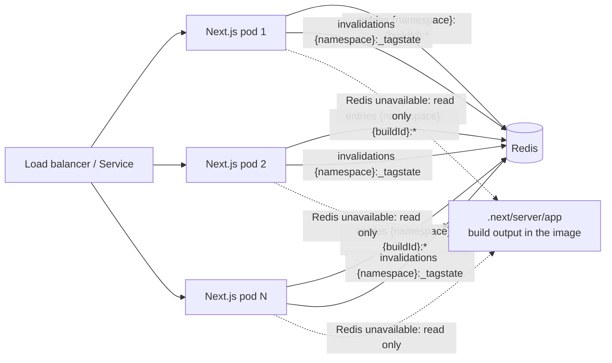

# @mirunamu/next-redis-cache

[](https://www.npmjs.com/package/@mirunamu/next-redis-cache)
[](https://opensource.org/licenses/MIT)
[](https://nextjs.org)
[](https://github.com/mirunamu00/next-redis-cache/actions/workflows/ci.yml?query=branch%3Amaster)
[](https://github.com/mirunamu00/next-redis-cache/actions/workflows/nightly.yml?query=branch%3Amaster)

**Redis cache handler for Next.js 16** - one package for both cache interfaces: the `cacheHandler` (ISR pages, route handlers, fetch cache) and the `"use cache"` `cacheHandlers`. Every instance of a self-hosted app - Kubernetes pods, containers, several `next start` processes - reads the same entries from one Redis and sees the same tag invalidations.

| | |
| --- | --- |
| Next.js | 16.1 and newer (`^16.1.0`; tested with 16.1 and 16.3). Next.js 15 is not supported by 2.x |
| What it caches | ISR and prerendered pages, route handlers and the fetch cache (`cacheHandler`); `"use cache"` functions and components (`cacheHandlers`) |
| Invalidation | `revalidateTag`, `updateTag` and `revalidatePath` reach every instance through one shared tag state |
| When Redis fails | prerendered pages are served from the build output; every Redis command has a timeout and a circuit breaker - see [When Redis is unavailable](#when-redis-is-unavailable) |
| Deployments | entries are separated per build, rolling updates and rollbacks are supported, old builds are cleaned up |
| Tested with | Redis 7.2 and 8.4, Node.js 22 and 24, end-to-end with two instances, 15 chaos scenarios - see [Testing and verification](#testing-and-verification) |

Upgrading from 1.x? Read [MIGRATION.md](https://github.com/mirunamu00/next-redis-cache/blob/master/MIGRATION.md). Deploying to Kubernetes? Read the [multi-instance deployment guide](https://github.com/mirunamu00/next-redis-cache/blob/master/docs/kubernetes.md).

## Why this package?

By default, every Next.js server keeps its own cache: entries in memory and in `.next/cache` on its own disk, `"use cache"` entries in memory. The Next.js documentation [points this out for self-hosting](https://nextjs.org/docs/app/guides/self-hosting#caching-and-isr): with several instances, each one has its own copy. In practice that means:

- every instance renders and stores the same page on its own, and a new pod starts with an empty cache;
- `revalidateTag()`, `updateTag()` or `revalidatePath()` only reach the instance that handled the request, so other instances keep serving the old content.

This package replaces both caches with handlers that store entries in Redis and record invalidations in one shared tag state, following Next's own rules for when an entry is fresh, stale or expired. A single `next start` process with a persistent disk does not need it.

## Highlights

- **Next.js semantics** - `revalidateTag(tag, profile)`, `updateTag(tag)` and `revalidatePath()` behave like Next's own caches: profiles are stale-while-revalidate, `updateTag` is read-your-own-writes, and a `dynamicParams = false` page never answers 404 because of an invalidation.
- **Never down because Redis is** - prerendered pages and route handlers are served from the build output (`.next/server/app`) when Redis is empty, flushed, evicted, slow or unreachable, and are written back to Redis when it is usable again.
- **Bounded waits** - the first connection waits at most 1 s, reads 1 s, writes 2 s; a timeout opens a circuit breaker so an unresponsive Redis costs one timeout, not one per request. Nothing is queued while the client is disconnected.
- **Small and cheap** - at most two round trips per cache hit (the entry with the request's tags, then the entry's own tags); binary entries (no base64) compressed with brotli - about 85% less memory than 1.x for a typical site.
- **Deployments without leftovers** - every key has a TTL except two shared keys; old builds are removed after a rollout (the previous build is kept for rollbacks, builds still in use are kept until idle).
- **Observable** - transition-based logging (one warning per outage, one line on recovery) and an `onEvent` hook for metrics.

## Requirements

| Package         | Version                                                   |
| --------------- | --------------------------------------------------------- |
| `next`          | `^16.1.0` (tested: 16.1, 16.3)                            |
| `@redis/client` | `^5.0.0 \|\| ^6.0.0` (the official client, not `ioredis`) |
| Redis server    | 6.2 or newer (tested: 7.2, 8.4); `tagStateTtlSeconds` needs 7.4 |
| Node.js         | `>=20.9.0` (tested: 22, 24)                               |

```bash
npm install @mirunamu/next-redis-cache @redis/client
```

## Quick Start

One shared configuration, two handler files, the Next.js config and (optionally) instrumentation.

```js
// cache/config.mjs
import { connectRedis } from "@mirunamu/next-redis-cache/redis";

/** @type {import("@mirunamu/next-redis-cache").RedisCacheConfig} */
export const cacheConfig = {
  // Waits at most 1 s for the first connection and keeps reconnecting in the background.
  // Without REDIS_URL the handlers run without Redis (pages come from the build output).
  client: () => connectRedis(process.env.REDIS_URL),
  // Every build of the app shares the namespace; the build id separates the builds' entries.
  namespace: "my-app",
  // Default: process.env.BUILD_ID, then .next/BUILD_ID
  buildId: process.env.BUILD_ID,
};
```

```js
// cache-handler.mjs
import { createCacheHandler } from "@mirunamu/next-redis-cache";
import { cacheConfig } from "./cache/config.mjs";

export default createCacheHandler(cacheConfig);
```

```js
// use-cache-handler.mjs
import { createUseCacheHandler } from "@mirunamu/next-redis-cache/use-cache";
import { cacheConfig } from "./cache/config.mjs";

export default createUseCacheHandler(cacheConfig);
```

```ts
// next.config.ts
import type { NextConfig } from "next";

const nextConfig: NextConfig = {
  cacheHandler: require.resolve("./cache-handler.mjs"),
  cacheHandlers: {
    default: require.resolve("./use-cache-handler.mjs"),
    remote: require.resolve("./use-cache-handler.mjs"),
  },
  cacheMaxMemorySize: 0, // no per-instance memory cache: every instance reads the shared Redis
  generateBuildId: async () => process.env.BUILD_ID || null,
};

export default nextConfig;
```

```ts
// instrumentation.ts
export async function register() {
  if (process.env.NEXT_RUNTIME === "nodejs") {
    const { startCacheMaintenance } = await import("@mirunamu/next-redis-cache/instrumentation");
    const { cacheConfig } = await import("./cache/config.mjs");
    // Background task, never awaited: registers this build and removes old builds' keys once Redis is ready
    startCacheMaintenance({ config: cacheConfig });
  }
}
```

That is all. During `next build` the handlers are no-ops (nothing connects), and in `next dev` there is no build-output fallback.

## Multi-instance deployment (Kubernetes)



Build the app once and run the same image in every pod, so that every pod has the same build id: entries are shared between the pods of one build, and invalidations between all pods. The [deployment guide](https://github.com/mirunamu00/next-redis-cache/blob/master/docs/kubernetes.md) covers build ids, environment variables, rolling updates and rollbacks, Redis settings and the limits during a Redis outage.

## How it works

### Keys

```
{namespace}:{buildId}:e:{cacheKey}   legacy entry ("e") - binary envelope, always a TTL
{namespace}:{buildId}:u:{cacheKey}   "use cache" entry ("u") - binary envelope, always a TTL
{namespace}:_tagstate                tag state of every build (hash, two fields per tag)
{namespace}:_builds                  build registry (sorted set: build id -> last start)
```

Entries are build-scoped, so a new build never reads an old build's HTML. The tag state is namespace-wide: an invalidation also reaches instances of other builds that are still running.

### Tag invalidation

There is no tag -> key index and no key is ever deleted by an invalidation (lazy invalidation, like Next's own caches). An invalidation writes one `HSET` with the time of the invalidation; entries are checked against it when they are read:

| Next.js call | Recorded | Next read of an older entry |
| --- | --- | --- |
| `updateTag(tag)`, `revalidatePath(path)`, `revalidateTag(tag)` | expired = now | `"use cache"`: a miss. Pages and route handlers: a miss, so Next renders before answering (read-your-own-writes) - except for a prerendered path of a `dynamicParams = false` route, where a miss would be a 404: that one is answered with the old entry and `lastModified: -1` (see `onTagExpired`). Fetch cache: a miss |
| `revalidateTag(tag, "max")` or any profile | stale = now, expired = now + profile `expire` | `"use cache"`: served once with `revalidate: -1` while Next regenerates it. Pages and route handlers: `lastModified: -1` (Next 16.1 serves it once and regenerates in the background, 16.3+ regenerates before answering). Fetch cache: served stale |

The rules are Next's own (`areTagsExpired` / `areTagsStale`), checked by property tests against Next's implementation. Implicit tags of a `"use cache"` read (`softTags`) are checked in `get()` in the same round trip as the entry, so `getExpiration()` returns `Infinity`.

An entry rendered after a miss is stored with the time of that miss as `lastModified`: an invalidation that lands while the render is still running is newer than the entry, so the result is not served as fresh.

### Build-output fallback

A custom `cacheHandler` replaces Next's file-system cache entirely: without a fallback, a prerendered page that is not in Redis is a cache miss, and a `dynamicParams = false` route answers 404. The legacy handler therefore reads prerendered pages (`APP_PAGE`) and route handlers (`APP_ROUTE`) from `.next/server/app` with Next's own `FileSystemCache` (read only) whenever Redis has no entry or is unavailable:

- checked against the tag state: invalidated after the build -> answered like an expired entry (above);
- fresh -> served with the file time as `lastModified` and written back to Redis (`SET NX`, TTL from `prerender-manifest.json`);
- Redis unavailable -> served as it is (the tag state is unknown).

Prewarming is therefore optional: every page is served from the build output on its first request and re-seeded. `startCacheMaintenance({ config, prewarm: true })` or `prewarmFromBuildOutput(config)` writes all of them at startup instead.

### Connection, timeouts and the circuit breaker

The package never calls `client.connect()` itself and sends nothing while `client.isReady` is false - no command is parked in the client's offline queue and replayed after a reconnect. `connectRedis()` waits at most `waitMs` (1 s) for the first connection, keeps reconnecting in the background and shares one client per URL in the process.

Every command is bounded by `timeouts.readMs` (1000) or `timeouts.writeMs` (2000). A timeout opens the circuit breaker for `circuitBreaker.openMs` (10 s): meanwhile every call is answered without Redis at once (misses, build-output fallback), then Redis is tried again. Command errors such as `WRONGTYPE` or `OOM` do not open the circuit.

### When Redis is unavailable

Unreachable, unresponsive, refusing the password or not configured at all - the app keeps answering, with these consequences:

| What | Behavior while Redis is unavailable |
| --- | --- |
| Prerendered pages and route handlers | Served from the build output (`.next/server/app`), in the version of the build |
| Pages regenerated after the build (ISR), other legacy entries | A miss: Next renders them for each request |
| `"use cache"` entries | A miss: the function runs for each request |
| `revalidateTag()`, `updateTag()`, `revalidatePath()` | Not recorded: logged as a failure and not retried, so other instances never see that invalidation |
| Request latency | At most one `readMs` per round trip until the first timeout opens the circuit, then no wait while it is open |

When Redis is usable again, reads go back to Redis and build-output pages are written back. The circuit only reacts to timeouts; a lost connection is detected by the client (`isReady`), so nothing waits for it.

### TTLs and memory

- Legacy entries: `ttl.estimateExpire(revalidate)` for a numeric revalidate (default `revalidate * 1.5`), otherwise `ttl.staticSeconds` (30 days); at most `ttl.maxSeconds` (365 days). The TTL counts from the write.
- `"use cache"` entries: the remaining lifetime until `expire`.
- Entries are stored as a binary envelope (Buffers and segment maps as raw bytes) compressed with brotli (`compression`, default `"brotli"`; `"gzip"` and `"none"` are available, and every setting reads entries written with any other).
- `{namespace}:_tagstate` and `{namespace}:_builds` have no TTL: they are bounded by the number of tags and builds, and a `volatile-*` eviction policy never evicts them. With Redis 7.4+, `tagStateTtlSeconds` puts a per-field TTL on the tag state.

In the repository's measurements one static-site build (176 entries) takes 17.4 MB with brotli, 20.5 MB with gzip and 122.5 MB uncompressed (1.1.0: 149.5 MB), at the same latency.

### Old builds and rolling updates

`startCacheMaintenance()` (or `cleanupOldBuilds()`) registers the starting build in `{namespace}:_builds`, then:

1. keeps the current build and the `keepPrevious` (1) most recently started other builds - a rollback re-registers the old build, which becomes current again;
2. deletes any other build only when **all** of its keys have been idle (`OBJECT IDLETIME`) for `minIdleSeconds` (30 min) - instances of the old build still serving during a rolling update keep reading their keys, so they are kept until the rollout is over. Keys whose idle time cannot be read (LFU eviction policy) count as in use;
3. caps the TTL of kept previous builds and of builds kept by rule 2 at `retiredTtlSeconds` (1 day).

A build kept by rule 2 is checked again by the same instance `minIdleSeconds` (+1 s) later, up to `rechecks` (3) times while builds stay deferred, so it is removed once nobody reads it - without waiting for the next deployment. Redis counts the EXPIRE of rule 3 as an access, so a build capped as the previous one looks used for `minIdleSeconds` when the next build starts soon after; the recheck covers that too, and the TTL cap stays as the safety net.

It waits for Redis to be ready, retries with backoff, never rejects and logs one line per run. Keys written by 1.x in the same namespace (`{namespace}:{build}:{key}` and the 1.x tag hashes) are removed by the same rules.

## Configuration

### `RedisCacheConfig` (both handlers, maintenance, prewarm)

| Option | Type | Default | Description |
| --- | --- | --- | --- |
| `client` | client, `null`, or `() => client \| null \| Promise<...>` | **required** | The `@redis/client` client, or a function returning it (called until it returns a client). `null` = no Redis |
| `namespace` | `string` | **required** | First key segment, shared by every build of the app. No `*?[]\` or whitespace |
| `buildId` | `string` | `BUILD_ID` env, then `.next/BUILD_ID` | Second key segment. No `:`, must not start with `_` |
| `timeouts` | `{ readMs?, writeMs? }` | `1000` / `2000` | Per-command timeouts |
| `circuitBreaker` | `{ openMs? } \| false` | `{ openMs: 10000 }` | Skip Redis for `openMs` after a timeout; `false` disables |
| `fallback` | `{ buildOutput?, reseed? } \| false` | `true` / `true` | Build-output fallback and re-seeding (production server only) |
| `ttl` | `{ staticSeconds?, maxSeconds?, estimateExpire? }` | 30 d / 365 d / `s => Math.floor(s * 1.5)` | Legacy entry TTLs |
| `onTagExpired` | `"auto" \| "stale" \| "miss"` | `"auto"` | Pages and route handlers with an expired tag: `"auto"` = miss unless that would be a 404 (`dynamicParams = false`), `"stale"` = always `lastModified: -1`, `"miss"` = always a miss |
| `compression` | `"brotli" \| "gzip" \| "none"` | `"brotli"` | Compression of entries of 1 KiB and more |
| `tagStateTtlSeconds` | `number` | none | Redis 7.4+: per-field TTL of the tag state. Choose more than `ttl.maxSeconds`: once a field expires, entries older than that invalidation (the build output included) count as fresh again |
| `logger` | `{ debug?, info?, warn?, error? } \| false` | console | `false` silences the package; debug output needs `NEXT_PRIVATE_DEBUG_CACHE` with the default logger |
| `onEvent` | `(event: CacheEvent) => void` | none | Metrics hook, see [Observability](#observability) |
| `disabled` | `boolean \| () => boolean` | `true` during `next build` | No-op handlers |

`createUseCacheHandler` also accepts:

| Option | Type | Default | Description |
| --- | --- | --- | --- |
| `swr` | `boolean` | `true` | Return entries past `revalidate` (Next regenerates them in the background). `false` = a miss, like Next's in-memory handler |
| `tagStateCacheMs` | `number` | `0` | Keep tag state in memory for this long: saves the second round trip, but invalidations made by other instances are seen up to that much later (this instance's own at once) |

### `connectRedis(url, options?)` - `@mirunamu/next-redis-cache/redis`

| Option | Default | Description |
| --- | --- | --- |
| `waitMs` | `1000` | Longest wait for the first connection |
| `label` | `"redis"` | Name in log lines |
| `clientOptions` | - | Extra `createClient` options (`socket`, `database`, `RESP`, ...) |
| `logger` | console | As above |
| `shared` | `true` | One client per URL in the process (the handlers and the maintenance task are separate modules) |

Returns `null` without a URL. `closeSharedClients()` destroys the shared clients (graceful shutdown, tests).

### `startCacheMaintenance({ config, cleanup?, prewarm? })` - `@mirunamu/next-redis-cache/instrumentation`

| Option | Default | Description |
| --- | --- | --- |
| `cleanup` | `{}` (on) | `{ keepPrevious = 1, minIdleSeconds = 1800, retiredTtlSeconds = 86400, rechecks = 3, attempts = 10, baseDelayMs = 2000, maxDelayMs = 300000 }`, or `false` |
| `prewarm` | `false` | `true` or `{ concurrency = 8, distDir }`: write every prerendered route into Redis |

Returns `{ done, stop }`: `done` is a promise of the first run's results and never rejects; `stop()` cancels pending rechecks (their timers never keep the process alive).

## API

| Entry point | Exports |
| --- | --- |
| `@mirunamu/next-redis-cache` | `createCacheHandler(config)` - the class for `cacheHandler`; types (`RedisCacheConfig`, `CacheEvent`, ...) |
| `@mirunamu/next-redis-cache/use-cache` | `createUseCacheHandler(config)` - the object for `cacheHandlers` |
| `@mirunamu/next-redis-cache/redis` | `connectRedis(url, options)`, `closeSharedClients()` |
| `@mirunamu/next-redis-cache/instrumentation` | `startCacheMaintenance(options)`, `cleanupOldBuilds(client, options)`, `prewarmFromBuildOutput(config, options)`, `whenReady(client, task, retry)`, `cleanupOldBuildKeys(options)` (deprecated 1.x pattern cleanup, removed in 3.0) |

Both ESM and CommonJS are published, with type declarations for each.

## Observability

Log lines start with `[next-redis-cache]`. Failures are logged on transitions only: the first failure of an outage is a warning, further failures are summarized at most once a minute, and the recovery is one info line. A missing client (`client: null`, no `REDIS_URL`) is one info line, not a failure.

`onEvent` receives, synchronously on the request path (keep it cheap; exceptions are ignored):

| `type` | Fields | When |
| --- | --- | --- |
| `hit` | `handler`, `key` | Entry served from Redis |
| `stale` | `handler`, `key`, `reason: "tag"` | Served stale because of a tag |
| `miss` | `handler`, `key`, `reason` | `absent`, `expired`, `tag`, `unavailable`, `error`, `format`, `disabled` |
| `set` | `handler`, `key`, `bytes` | Entry written |
| `fallback` | `key`, `state` | Served from the build output: `fresh`, `stale`, `unknown` (Redis unavailable) |
| `reseed` | `key` | Build-output entry written back to Redis |
| `error` | `handler`, `op`, `key`, `error` | A Redis command failed (not for unavailability) |
| `circuit` | `state`, `reason` | Circuit breaker opened or closed |

For example, the time a request waits for Redis is bounded by `readMs` per round trip, and the share of `fallback` events tells how often Redis could not answer.

## Caching with `cacheLife`

`"use cache"` entries follow the profile of the function:

```ts
// app/catalog.ts
import { cacheLife } from "next/cache";

export async function getCatalog() {
  "use cache";
  cacheLife("hours"); // stale: 5m, revalidate: 1h, expire: 1d
  return [{ id: 1 }];
}
```

The entry is stored until `expire` (1 day); after `revalidate` (1 hour) it is returned and regenerated in the background.

## Testing and verification

Every layer below exists in this repository and runs in GitHub Actions; the badges at the top show the latest result on `master`. A release is published only from a commit that passed the full CI matrix and the chaos subset ([release.yml](https://github.com/mirunamu00/next-redis-cache/blob/master/.github/workflows/release.yml)), with npm provenance.

| Layer | What it checks | When |
| --- | --- | --- |
| Unit and property | keys, entry format, TTLs, tag checks against Next's rules, circuit breaker, logging (Node.js 22, 24 and Windows) | every push and PR |
| Integration | command semantics against real Redis 7.2 and 8.4, with `@redis/client` 5 and 6 | every push and PR |
| Fault injection | Redis before connect, disconnected, reconnecting, unresponsive, slow, resetting connections | every push and PR |
| Contract | type compatibility with Next.js 16.1 and 16.3 (and canary nightly); the `"use cache"` handler is compared with Next's default handler on generated operation sequences; the code blocks of this README are type-checked | every push and PR |
| End-to-end | three test apps on two instances sharing one Redis: HTML, RSC, segment prefetch, invalidation across instances | PR: Next.js 16.3 x Redis 8.4; nightly: 16.1 and 16.3 x Redis 7.2 and 8.4 |
| Chaos | C1-C15: Redis absent at startup, killed, unresponsive, slow, flushed, evicted, restarted, wrong password, wrong key type, rolling update, rollback, invalidation during a render, clock skew between instances | nightly; a subset before every release |
| Performance | Redis commands per request and memory of one build against a committed baseline | every push and PR |
| Coverage and mutation | merged coverage thresholds; mutation score of at least 70 % | coverage on every push and PR, mutation weekly |

Measured results recorded in the repository (conditions in [tests/perf](https://github.com/mirunamu00/next-redis-cache/blob/master/tests/perf/README.md)):

- A cache hit of a page costs 2 Redis commands (`GET` of the entry, `HMGET` of its tags).
- One build of the static-site test app (176 entries) takes 17.4 MB in Redis with brotli, against 149.5 MB with 1.1.0.
- The weekly mutation score in CI was 84.78 % on 2026-09-29.

Every layer can be run locally (`npm test`, `npm run test:int`, `npm run test:e2e`, ...); Docker is needed for Redis, toxiproxy and the end-to-end fleet.

## Security

Anyone who can write to the Redis database decides what your site serves: cache entries contain the complete HTML, RSC payloads and route handler responses that Next.js sends to users. Treat Redis write access like deploy access.

- Require authentication (`requirepass` or ACL users) and keep Redis on a private network; use TLS (`rediss://`) when traffic leaves a trusted network.
- Do not share the database with untrusted tenants or applications. The namespace separates applications; it is not an access boundary - use ACL key patterns if you need one.
- Entries are decoded as data only (no code is evaluated), but their content is served as-is.
- `connectRedis` removes the password from its log lines; do not log `REDIS_URL` yourself.

## License

[MIT](LICENSE)
