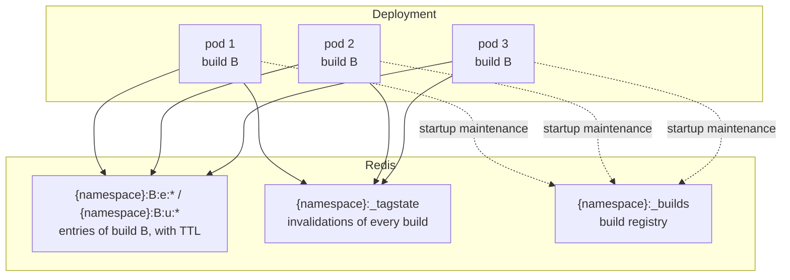

# Next.js 16 on Kubernetes with a shared Redis cache

This guide is for self-hosted Next.js 16 apps that run more than one server instance - Kubernetes pods, containers behind a load balancer, or several `next start` processes - and use `@mirunamu/next-redis-cache` to share one cache between them. The setup itself is in the [README Quick Start](../README.md#quick-start); this page explains what changes when there are several instances and what to configure for production.

## The problem: one cache per pod

Without a custom cache handler, every Next.js server keeps its own cache:

- ISR and prerendered pages, route handlers and the fetch cache: in memory and in `.next/cache` on the pod's own file system;
- `"use cache"` entries: in memory.

With three pods there are three caches. Each pod renders the same page on its own, a new pod (scale-up, restart, rollout) starts with an empty cache, and an invalidation - `revalidateTag()`, `updateTag()`, `revalidatePath()` - only reaches the pod that handled that request. The other pods keep serving the old content until their own copy expires. The Next.js documentation describes this in [Self-hosting: Caching and ISR](https://nextjs.org/docs/app/guides/self-hosting#caching-and-isr).

## How the pods share one cache



| Next.js setting | Handler | Stores |
| --- | --- | --- |
| `cacheHandler` | `createCacheHandler()` | ISR and prerendered pages, route handlers, fetch cache (`{namespace}:{buildId}:e:*`) |
| `cacheHandlers.default` / `.remote` | `createUseCacheHandler()` | `"use cache"` entries (`{namespace}:{buildId}:u:*`) |
| `cacheMaxMemorySize: 0` | - | Turns off Next's per-instance memory cache, so every read goes to the shared Redis |

Both handlers write invalidations to the same `{namespace}:_tagstate` hash. A `revalidateTag("posts")` on pod 1 is one `HSET`; pod 2 and pod 3 check every entry they read against that hash, so the invalidation applies to them on their next read. There is no pub/sub and no per-pod state to synchronize. The exception is `tagStateCacheMs` of the `"use cache"` handler: when you set it, other pods' invalidations are seen up to that many milliseconds later.

## Build once, run the same image everywhere

Entries are stored per build id (`{namespace}:{buildId}:...`): the HTML and RSC payloads of one build must never be served by another. All pods of one release therefore need the same build id, and they have it when they run the same image built by one `next build`:

- The handlers read `config.buildId`, which defaults to `process.env.BUILD_ID` and then to `.next/BUILD_ID` of the build.
- The README sets `generateBuildId: async () => process.env.BUILD_ID || null` so that a known value - typically the commit SHA - names the build in Redis keys and logs. Pass it to `next build` (for example as a Docker build argument). At run time either set the same `BUILD_ID` or leave it unset; `.next/BUILD_ID` then provides it.
- Do not run `next build` when a container starts. Every pod would produce its own build id and its own entries, so nothing would be shared.

The `namespace` stays the same for every build of one app. Use different namespaces for different apps or environments that share one Redis database (for example `shop` and `shop-staging`).

The repository's end-to-end and chaos tests run the test apps with `output: "standalone"` on two instances sharing one Redis.

## Environment variables

| Variable | Where | Purpose |
| --- | --- | --- |
| `REDIS_URL` | run time, from a Secret | Read by your `cache/config.mjs` (`connectRedis(process.env.REDIS_URL)`). Unset: the handlers run without Redis and log one info line. Use `rediss://` for TLS |
| `BUILD_ID` | build time; optional at run time | Names the build (see above). Must not contain `:` or start with `_` |
| `NEXT_PRIVATE_DEBUG_CACHE` | run time, temporarily | Debug output of the default logger (per-request lines; not for normal operation) |

A minimal Deployment fragment:

```yaml
apiVersion: apps/v1
kind: Deployment
metadata:
  name: web
spec:
  replicas: 3
  strategy:
    type: RollingUpdate
  template:
    spec:
      containers:
        - name: web
          image: registry.example.com/web:3f2c1ab # built once with BUILD_ID=3f2c1ab
          env:
            - name: REDIS_URL
              valueFrom:
                secretKeyRef:
                  name: web-redis
                  key: url
```

## Rolling updates and rollbacks

During a rollout from build A to build B, pods of both builds serve traffic at the same time:

- Entries are build-scoped: B pods never read A's HTML, and A pods keep reading their own entries until they stop.
- The tag state is shared by both builds, so an invalidation made on a B pod also reaches the A pods that are still running.
- `startCacheMaintenance()` in `instrumentation.ts` registers each starting build in `{namespace}:_builds`. It keeps the current build and the previous one (`keepPrevious: 1`) with their TTLs capped to one day, and deletes an older build only once all of its keys have been idle for `minIdleSeconds` (30 minutes) - a build that is still being read during the rollout is kept and checked again later.
- A rollback to A re-registers A, which becomes the current build again. Its entries are still there if A was the previous build and its TTL cap has not run out; otherwise its pages come from the build output and are written back.

Rolling update A -> B and rollback B -> A are chaos scenarios C11 and C12, and the removal of a build still read during a rollout is C15 (see [Testing and verification](../README.md#testing-and-verification)).

## When Redis is unavailable

The app keeps answering when Redis is down, slow, or refuses the password, but the cache does not behave the same:

- Prerendered pages and route handlers are served from `.next/server/app` in the image, in the version of the build. Pages regenerated after the build (ISR) and other legacy entries are misses, so Next renders them for every request.
- `"use cache"` entries are misses: the functions run for every request. Size your data sources for that load if Redis outages are possible.
- Invalidations made during the outage are not recorded in Redis. They are logged as failures and not retried, so other pods never see them. Prerendered pages served from the build output are not checked against the tag state while Redis is unavailable.
- Every command waits at most `timeouts.readMs` (1 s) or `timeouts.writeMs` (2 s); the first timeout opens the circuit breaker for 10 s, during which no request waits for Redis.

After Redis comes back, reads go back to Redis and build-output pages are written back to it. The README has the [full table](../README.md#when-redis-is-unavailable).

## Redis settings

- **Eviction policy**: use a `volatile-*` policy such as `volatile-lru`. Every key has a TTL except `{namespace}:_tagstate` and `{namespace}:_builds`, which a `volatile-*` policy never evicts. With an `allkeys-*` policy Redis may evict the tag state, and entries invalidated before that would count as fresh again. With an LFU policy the cleanup cannot read idle times and keeps old builds until their TTL cap expires.
- **Memory**: one build of the repository's static-site test app (176 entries) takes 17.4 MB with the default brotli compression. Measure your own app (`MEMORY USAGE`, or the `set` events' `bytes`) and leave room for the previous build during rollouts.
- **Persistence**: optional for entries, which are re-created from the build output or by rendering. The tag state is the only data that cannot be re-created: a Redis restart without persistence (or with a rolled-back AOF, chaos scenario C8) forgets invalidations made since the last save.
- **Security**: anyone who can write to the database decides what the site serves. Require authentication, keep Redis on a private network and use TLS outside it - see [Security](../README.md#security).

## Checklist

- [ ] The image is built once; all pods of a release run the same image (same `.next/BUILD_ID`).
- [ ] `cacheHandler`, `cacheHandlers.default` (and `remote` if you use `"use cache: remote"`) point to the two handler files; `cacheMaxMemorySize: 0`.
- [ ] `REDIS_URL` comes from a Secret; `namespace` is set per app and environment.
- [ ] `instrumentation.ts` starts `startCacheMaintenance({ config })` so old builds are removed.
- [ ] Redis uses a `volatile-*` eviction policy and has room for two builds.
- [ ] After a rollout, each pod logs a `cleanup:` line and no repeated `[next-redis-cache]` warnings; `redis-cli --scan --pattern '<namespace>:*'` shows keys of the current and previous build only.
